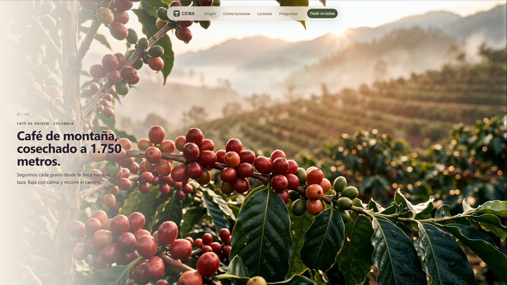
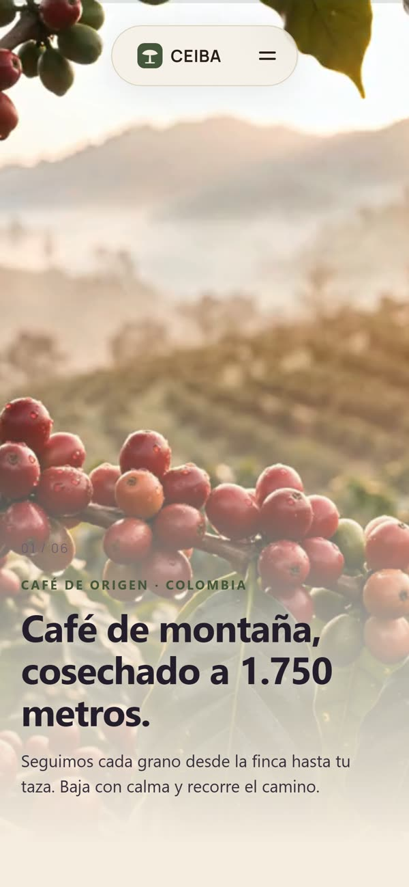
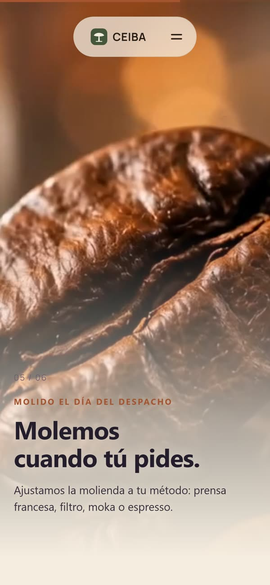
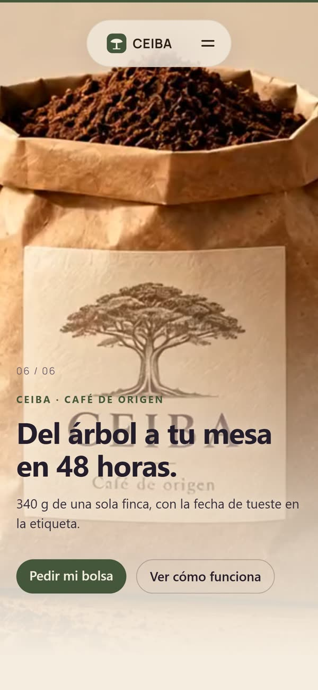
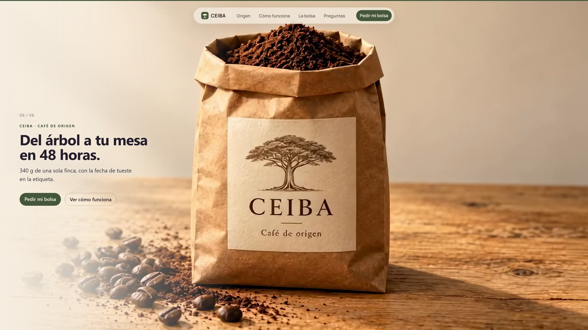

<div align="center">

# CEIBA · Café de origen

**Del árbol a tu mesa en 48 horas.**
Landing de café de especialidad ecuatoriano contada como un solo recorrido de cámara: bajas con el scroll y viajas del cafetal a la bolsa.

[**Ver el sitio en vivo →**](https://charliecardenastoledo.github.io/ceiba/)

<br />



</div>

## En el celular

<table>
  <tr>
    <td align="center" width="33%"><br /><sub>01 · El cafetal</sub></td>
    <td align="center" width="33%"><br /><sub>05 · Molienda al pedido</sub></td>
    <td align="center" width="33%"><br /><sub>06 · Tu bolsa</sub></td>
  </tr>
</table>

## El cierre en escritorio



## Cómo funciona

El recorrido son seis clips de video encadenados (cafetal, cosecha, secado, tostión, molienda y bolsa). El scroll no reproduce el video: lo **controla**. Cada píxel que bajas mueve el `currentTime` del clip, así que la cámara avanza al ritmo del usuario y se detiene si deja de bajar.

- **Un video para cada pantalla.** El motor elige el archivo según el dispositivo: 720p con más keyframes en celular, AV1 donde el navegador lo decodifica por hardware, H.264 como respaldo y 2560 px en pantallas grandes.
- **Carga diferida.** Cada clip se descarga solo cuando su escena está cerca. Mientras llega, se muestra una imagen fija `.webp` de la escena.
- **Accesible.** Con `prefers-reduced-motion` no se carga ningún video: las imágenes fijas se funden entre sí al hacer scroll.
- **Sin dependencias.** El motor (`src/scripts/scroll-world.js`) es JavaScript puro y crea su propio DOM y CSS.

## Stack

| | |
| :-- | :-- |
| Framework | [Astro](https://astro.build) |
| Estilos | Tailwind CSS 4 |
| Íconos | `astro-icon` + Phosphor |
| Analítica | [Umami](https://umami.is) (sin cookies) |
| Hosting | GitHub Pages, desplegado con GitHub Actions |

## Analítica

Además de las visitas, Umami recibe estos eventos (en `src/scripts/analytics.ts`):

| Evento | Cuándo se envía |
| :-- | :-- |
| `seccion-1-cafetal` … `seccion-6-tu-bolsa` | La primera vez que el visitante llega a cada escena |
| `scroll-25` / `50` / `75` / `100` | Al pasar por cada porcentaje de la página |
| `cta-comprar` | Clic en cualquier enlace a `#comprar` |
| `pedido-enviado` | Envío del formulario de prueba, con la molienda elegida |

Con los eventos de sección se arma un embudo en Umami para ver en qué escena se va la gente.

## Desarrollo

Requiere Node 22.12 o superior (`.nvmrc` fija la 24).

```sh
npm install
npm run dev       # servidor local en http://localhost:4321/ceiba/
npm run build     # genera el sitio en ./dist/
npm run preview   # sirve el build localmente
```

El sitio usa `base: '/ceiba'`. Las rutas a archivos de `public/` y los enlaces internos pasan por `withBase()` (`src/lib/url.ts`), para que funcionen igual en local y en GitHub Pages.

## Despliegue

Cada push a `main` ejecuta `.github/workflows/deploy.yml`, que compila el sitio y lo publica en GitHub Pages.

## Estructura

```text
public/
  world/            # clips de las 6 escenas (celular, AV1, H.264, HD) e imágenes fijas
  products/         # foto del producto
src/
  pages/            # index, privacidad, términos, 404
  layouts/          # Layout base (meta tags, Umami)
  components/       # Nav, Footer, SimplePage
  scripts/          # scroll-world.js (motor del recorrido), analytics.ts
  lib/url.ts        # withBase() para el base path
docs/screenshots/   # imágenes de este README
```

